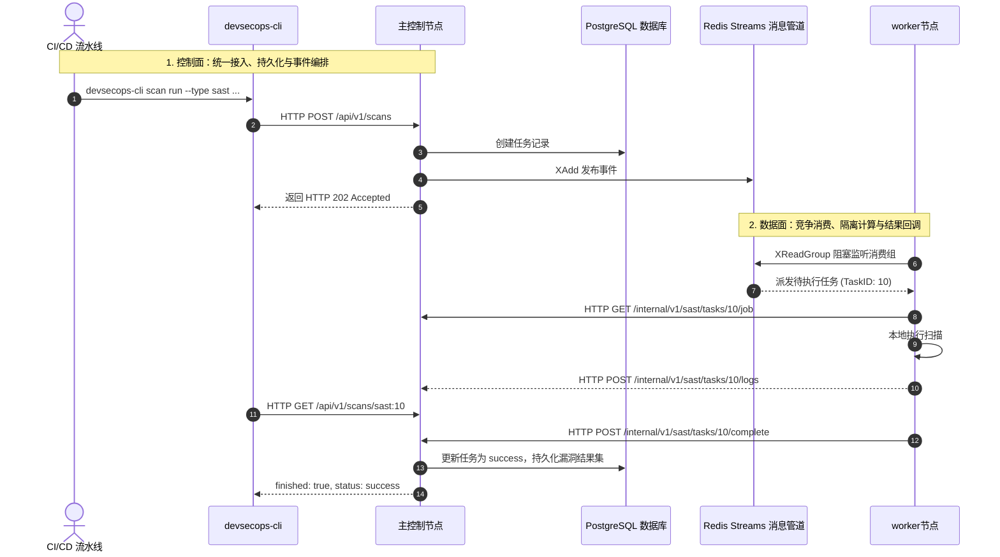

## 1. 项目结构



---


* **SAST**：主节点建单 $\rightarrow$ 投递 Redis Stream `sast.command.tasks` $\rightarrow$ `worker-sast` 竞争拉取 $\rightarrow$ Worker 拉取代码并调用 CodeQL 执行 AST 污点追踪 $\rightarrow$ 通过安全凭证（`X-Worker-Token`）回调主控节点落库 SARIF 报告。
* **DAST**：主节点建单 $\rightarrow$ 投递 Redis Stream `dast.command.raw` $\rightarrow$ `worker-dast` 通过两阶段流水线（IP 切片解析 $\rightarrow$ 端口探活 $\rightarrow$ 指纹识别 $\rightarrow$ PoC 验证）执行 $\rightarrow$ 结果直接回 Redis 状态字典。
* **SCA：主节点建单 $\rightarrow$ 服务端后台异步 Goroutine 快速解析依赖锁文件（`go.mod`、`pom.xml`、`package-lock.json` 等） $\rightarrow$ 批量匹配 OSV 权威漏洞库并落库。

---

## 2. 组件边界

| 组件名称 | 进程/二进制 | 定位与核心职责 |
| :--- | :--- | :--- |
| **CLI 客户端** | `devsecops-cli` | CI/CD 使用，负责任务提交、状态轮询与流水线退出码阻断。 |
| **主控制节点** | `devsecops-server` | 控制面。负责统一认证、仓库配置、流水线任务分发。 |
| **SAST 执行节点** | `devsecops-worker-sast` | CodeQL 静态白盒扫描执行节点。 |
| **DAST 执行节点** | `devsecops-worker-dast` | 网络资产探测与 Neutron PoC 验证节点 |
| **Web 前端** | `web/ (Vue 3)` | 提供任务监控、漏洞详情、Worker 节点探针等可视化功能。 |

---

## 3. `devsecops-cli` 使用

`devsecops-cli` 是为 CI/CD 管道使用的轻量客户端

### 3.1 环境变量配置
```bash
# 指定主节点地址（默认: http://192.168.1.14:22211）
export DEVSECOPS_SERVER="http://devsecops.company.internal:22211"
```

### 3.2 常用扫描指令

#### ① 一键提交并等待
使用 `scan run` 子命令，会在任务创建后自动阻塞轮询，直到扫描完成并根据最终结果返回退出码：
```bash
# 1. 执行 SAST 代码扫描并阻塞等待
devsecops-cli scan run \
  --type sast \
  --repo-id 1 \
  --branch main \
  --language go \
  --rule-profile baseline \
  --timeout 30m

# 2. 执行 DAST 测试
devsecops-cli scan run \
  --type dast \
  --target "https://staging.example.com" \
  --name "Staging-PR-102" \
  --ports "80,443,8080"

# 3. 执行 SCA 本地依赖成分分析
devsecops-cli scan run \
  --type sca \
  --target /path/to/project
```

#### ② 异步提交与手动等待
适合需要将提交步骤与轮询步骤解耦的脚本场景：
```bash
devsecops-cli scan submit --type sast --repo-id 1 --language java
# 输出示例: scan_id=sast:42 status=pending

# 针对已有 scan_id 进行状态轮询等待
devsecops-cli scan wait --scan-id sast:42 --timeout 45m --interval 5s
```

---

## 4. CI/CD 集成配置

### 4.1 Jenkins 配置

在 Jenkins 声明式流水线（Declarative Pipeline）中集成代码白盒扫描（SAST）、依赖成分分析（SCA）与动态渗透扫描（DAST）：

```groovy
pipeline {
    agent any

    environment {
        DEVSECOPS_SERVER = 'http://devsecops.company.internal:22211'
        // 本项目在平台预先登记的代码仓库 ID
        REPO_ID = '1'
    }

    options {
        timeout(time: 1, unit: 'HOURS')
        timestamps()
    }

    stages {
        stage('代码检出') {
            steps {
                checkout scm
            }
        }

        stage('SAST 静态代码白盒扫描') {
            steps {
                echo "[*] SAST 静态代码审计..."
                sh '''
                    devsecops-cli scan run \
                        --type sast \
                        --repo-id ${REPO_ID} \
                        --branch ${GIT_BRANCH} \
                        --language go \
                        --rule-profile baseline \
                        --timeout 25m
                '''
            }
        }

        stage('SCA 依赖分析') {
            steps {
                echo "[*] SCA 依赖分析..."
                sh '''
                    devsecops-cli scan run \
                        --type sca \
                        --target . \
                        --timeout 10m
                '''
            }
        }

        stage('部署至测试环境') {
            steps {
                echo "部署应用至测试集群以供 DAST 探测..."
                // 这里写部署指令
            }
        }

        stage('DAST 动态黑盒渗透') {
            steps {
                echo "[*] 针对测试环境执行 DAST 漏洞探测..."
                sh '''
                    devsecops-cli scan run \
                        --type dast \
                        --target "https://staging.example.com" \
                        --name "Jenkins-Build-${BUILD_NUMBER}" \
                        --ports "80,443" \
                        --timeout 15m
                '''
            }
        }
    }

    post {
        success {
            echo "合入发布分支"
        }
        failure {
            //todo...
        }
    }
}
```

### 4.2 GitHub Actions 工作流配置 (`.github/workflows/security.yml`)

```yaml
name: DevSecOps Quality Gate

on:
  pull_request:
    branches: [ main ]
  push:
    branches: [ main ]

jobs:
  security-gate:
    runs-on: ubuntu-latest
    steps:
      - name: Checkout Code
        uses: actions/checkout@v4

      - name: Run SAST Security Scan
        env:
          DEVSECOPS_SERVER: ${{ secrets.DEVSECOPS_SERVER_URL }}
        run: |
          ./devsecops-cli scan run \
            --type sast \
            --repo-id 1 \
            --branch ${{ github.head_ref || github.ref_name }} \
            --language go \
            --timeout 20m

      - name: Run SCA Dependency Audit
        env:
          DEVSECOPS_SERVER: ${{ secrets.DEVSECOPS_SERVER_URL }}
        run: |
          ./devsecops-cli scan run \
            --type sca \
            --target . \
            --timeout 10m
```

---

## 5. 项目目录结构

```text
├── cmd/
│   ├── cli/                    
│   ├── server/                 
│   ├── worker-sast/            
│   └── worker-dast/           
│
├── internal/
│   ├── pipeline/               
│   ├── router.go               
│   ├── messaging/              
│   ├── model/                  
│   ├── sast/                   
│   ├── dast/                   
│   ├── sca/                    
│   └── worker/                 
│
├── web/                        
├── configs/example.yaml        
└── data/pocs/                  
```

---

## 6. 构建与编译

静态链接 编译

```bash
CGO_ENABLED=0 go build -trimpath -ldflags="-s -w" -o devsecops-cli ./cmd/cli
CGO_ENABLED=0 go build -trimpath -ldflags="-s -w" -o devsecops-server ./cmd/server
CGO_ENABLED=0 go build -trimpath -ldflags="-s -w" -o devsecops-worker-sast ./cmd/worker-sast
CGO_ENABLED=0 go build -trimpath -ldflags="-s -w" -o devsecops-worker-dast ./cmd/worker-dast
```

运行测试与静态语法检查：
```bash
go test -count=1 ./...
go vet ./cmd/... ./internal/...
```

---

## 7. 生产部署

### 7.1 基础依赖部署 (PostgreSQL, Redis, CodeQL)

#### 1. Postgresql
```bash
mkdir -p /opt/devsecops/data/postgres

docker run -d --name devsecops-pg \
  --restart always \
  -p 5432:5432 \
  -e POSTGRES_USER=codeql \
  -e POSTGRES_PASSWORD=codeql123 \
  -e POSTGRES_DB=codeql_platform \
  -v /opt/devsecops/data/postgres:/var/lib/postgresql/data \
  postgres:15-alpine
```

#### 2. Redis 
```bash
mkdir -p /opt/devsecops/data/redis

docker run -d --name devsecops-redis \
  --restart always \
  -p 6379:6379 \
  -v /opt/devsecops/data/redis:/data \
  redis:alpine redis-server --appendonly yes
```

#### 3. CodeQL 运行环境配置 (Worker-SAST 宿主节点)
```bash
wget https://github.com/github/codeql-action/releases/latest/download/codeql-bundle-linux64.tar.gz -O /tmp/codeql-bundle-linux64.tar.gz

mkdir -p /opt/devsecops
tar -zxvf /tmp/codeql-bundle-linux64.tar.gz -C /opt/devsecops/
rm -f /tmp/codeql-bundle-linux64.tar.gz

/opt/devsecops/codeql/codeql version
```

---

### 7.2 服务日常运维指令

```bash
# 查看服务运行状态
systemctl status devsecops-server devsecops-worker-sast devsecops-worker-dast

# 日志
journalctl -u devsecops-server -f       
journalctl -u devsecops-worker-sast -f   
journalctl -u devsecops-worker-dast -f   

# 重启组件
systemctl restart devsecops-server devsecops-worker-sast devsecops-worker-dast
```
